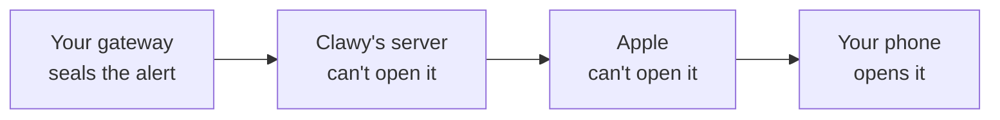

# Clawy notifications

> [!NOTE]
> Clawy is in internal alpha testing. "Clawy" is a working name, and the plugins, their install commands and this repo's name may still change before release.

Plugins for [OpenClaw](https://github.com/openclaw/openclaw) and [Hermes Agent](https://github.com/NousResearch/hermes-agent) that keep the text of your notifications away from Clawy's server.

Clawy is a closed source iPhone and iPad app for agents you host yourself. Apple only delivers notifications through a server, so by default Clawy's relay receives each alert from your gateway and decides what to show. With one of these plugins, your gateway decides instead. It seals each alert to a key that only your device holds and hands our server a blob it can't open.



## What this protects

**Our server can't read your notifications.** Your gateway seals each alert to a key only your device holds, so our server passes along something it can't open, and keeps no record of it. Every sealed alert is the same size, so even its length says nothing.

**Neither can Apple.** It sees the same sealed alert, behind the words "New notification".

**An alert does what it says.** Each one opens once, only on your device, and Allow approves exactly the command the alert shows.

## What it doesn't change

**The app sees your chats.** Clawy is a closed source client for your gateway, so you trust it with what it shows you, as with any client. These plugins take our server out of the picture, not the app.

**Apple and our server still know when to wake your device.** They see that a notification is on its way, and whether it's an alert or a quiet background refresh. Never what it says.

**The plugin sees your alerts.** It runs inside your gateway, with its access. It's under 500 lines per gateway with no dependencies of its own, so you can read it.

**It's for a gateway with one owner.** Every device registered with the plugin gets every alert.

More on what it does and doesn't guard against: [`SECURITY.md`](SECURITY.md).

## How it works

Four steps, each in a file you can read.

**1. Your device registers itself.** When you choose Open source plugins, Clawy makes a key pair on your device and keeps the private half in its Keychain. It gives your gateway the public half, plus an address and token for our forwarder, over its own connection: an OpenClaw gateway method that needs approval and question rights, or Hermes's authenticated dashboard connection. The plugin keeps that in a file on your gateway, and refuses any forwarder address but ours, so registering a device can't point your gateway somewhere else. OpenClaw: [`openclaw/devices.ts`](openclaw/devices.ts). Hermes: [`hermes/delivery.py`](hermes/delivery.py).

**2. It listens for what should alert.** On OpenClaw, that's the end of each agent run, approval requests, questions and failed scheduled tasks. For approvals and questions it signs in to its own gateway on `127.0.0.1`, as an app would ([`openclaw/index.ts`](openclaw/index.ts)). On Hermes, it's the `post_llm_call`, `on_session_end` and `on_human_input_request` hooks ([`hermes/__init__.py`](hermes/__init__.py)).

**3. It decides, then seals.** The same rules our relay uses pick an alert, a silent refresh or nothing ([`openclaw/route.ts`](openclaw/route.ts), and `reply_kind` in [`hermes/__init__.py`](hermes/__init__.py)). It numbers each message so it can't be shown twice, pads it to 2048 bytes, and encrypts it to your device's key with Web Push's standard `aes128gcm` (RFC 8291), using only Node's or Python's own crypto ([`openclaw/seal.ts`](openclaw/seal.ts), [`hermes/seal.py`](hermes/seal.py)).

**4. It posts the sealed message to our forwarder**, with one word beside it: alert or silent. That's the only request either plugin makes to the internet. The forwarder hands it to Apple, and your device's notification extension opens it with the private key, checks its number and shows it.

The exact message format, what the forwarder does with it and how it answers are in [`PROTOCOL.md`](PROTOCOL.md). Both plugins and the app are tested against the same sealed messages in [`test-vectors/`](test-vectors/).

## Install

### OpenClaw

```sh
openclaw plugins install git:linuz90/clawy-notifications#v0.2.0 --force --accept-capabilities
openclaw plugins enable clawy-notifications
```

`--force` is OpenClaw's confirmation for anything outside ClawHub's review, and `--accept-capabilities` accepts what the plugin declares. Both commands are needed: install can leave the plugin disabled. No restart. If you turned on owner access in Clawy, Settings › Notifications › Delivery can do this for you.

### Hermes Agent

```sh
hermes plugins install linuz90/clawy-notifications#hermes --enable
```

Install it in every profile selected in Clawy, using `hermes -p <profile> plugins install … --enable` for named profiles. Restart Hermes after installation to load its observers and routes; current dashboards can hot-mount the routes, while the legacy API listener mounts only at startup. To pin a reviewed commit, add `--ref <40-character-sha>`.

### Then, in Clawy

Open Settings › Notifications › Delivery and choose Open source plugins. Clawy finds the plugin and registers this device itself, so you never copy a key. Send Test passes only if this device opened the alert.

If the plugin stops working, Clawy says so on its chat list. It never moves you back to our relay on its own.

## What's here

| Path | What it is |
| --- | --- |
| [`PROTOCOL.md`](PROTOCOL.md) | The wire format, and what our forwarder does with it |
| [`openclaw/`](openclaw/) | The OpenClaw plugin. `dist/` is the same code with the types stripped |
| [`hermes/`](hermes/) | The Hermes plugin |
| [`test-vectors/`](test-vectors/) | Sealed messages and replay steps both plugins and the app are tested against |
| [`test/contract/`](test/contract/) | Installs a plugin on a real gateway and checks it end to end, nightly against the newest releases |

The repository root is also the OpenClaw package, because OpenClaw's git install takes the root of a repository.

## Test

```sh
npm test                                   # OpenClaw plugin
cd hermes && python -m unittest            # Hermes plugin, in an environment with cryptography and aiohttp
node test/contract/openclaw.mjs [version]  # needs a committed checkout
node test/contract/hermes.mjs [tag]        # also needs uv
```

Tested on OpenClaw `2026.10.7` and `2026.11.1`, and Hermes `v0.22.7` and `v0.23.0`.

## License

MIT. Reporting a security problem: [`SECURITY.md`](SECURITY.md).
